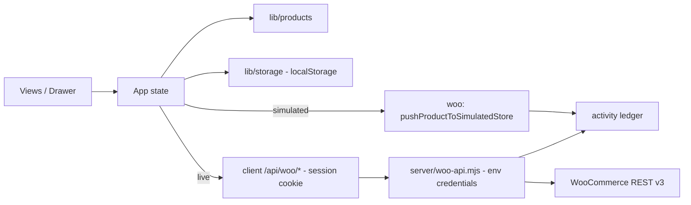

# PIM Sync

A product information workspace built for the **Kilowott Hackathon 2026**. Manage a product catalog — attributes,
pricing, stock, status — and keep it in step with a WooCommerce store. React 19 + Vite 8, no database, no
runtime services to stand up, and **113 passing tests**.

## Problem

Hackathon brief: build tooling to manage product information and synchronise it with a WooCommerce store. Teams
need a credible sync story that works without a real store at hand — and that never pretends an untested
integration works.

## Solution — the three challenge requirements

1. **Product catalog management** — create, view, edit, delete, search and filter products with real validation
   and `localStorage` persistence. Seeded with the required **Black T-Shirt (TSH-001, ₹499, 20 in stock)** plus
   five illustrative products.
2. **Attribute handling** — structured colour / size / material fields plus free-form attribute rows (name +
   comma-separated values); values are trimmed, empties dropped and duplicates rejected. Colour names resolve to
   swatches, with a deterministic monogram-tile fallback.
3. **WooCommerce synchronisation** — per-product and bulk sync with plain-English statuses, timestamps and an
   activity ledger. Two modes: **Simulated demo** (default; no network requests) and **Live store** (real
   WooCommerce REST v3 through a server-side proxy, where credentials never touch the browser).

> **Honest disclosure:** the live path has been verified against a **local WooCommerce 11.2.1 test store only**
> (Local by Flywheel) — real product create, update, re-sync and SKU lookup including stale-ID recovery all
> succeeded. It has **never been run against a production or remote store** — treat the first attempt there as a
> test, not a production operation.

## Key features

- **Product Catalog** — masthead stats, search across name/SKU/colour/size/material/category/description/
  attributes, category and sync filters, a manifest table with row numerals, swatches, attribute chips, price in
  ₹, stock with low-stock marks and per-row Sync / Edit / Delete actions (delete asks for confirmation).
  On narrow screens the table becomes stacked cards.
- **Create / edit drawer** — numbered sections, inline validation, focus moved to the first invalid field.
- **Synchronize page** — connection mode cards, a Connection panel covering four server states (checking /
  unreachable / unconfigured / configured) with the exact missing environment variables and copy-ready setup
  steps, a genuinely re-fetching **Check again** button, a queue with a "fail the next run" toggle for the
  error/retry flow (demo mode), and an activity ledger where every entry is tagged `Simulated demo` or
  `Live store` (newest first, with separate per-mode totals). The last-success summary always shows the most
  recent successful run by timestamp — a failed run never replaces it.
- **Light & dark theme** — follows the system preference until toggled; applied pre-paint with no flash, choice
  remembered in `localStorage`.
- **Security** — WooCommerce credentials live only in server-side environment variables. The proxy requires a
  session cookie and same-origin checks (plus an `X-PIM-Sync` header on writes), rejects cross-origin calls and
  preflights with 403, enforces HTTPS for remote stores and maps failures to safe error codes. Legacy
  credentials stored by older builds are purged on startup.
- **Storage hardening** — malformed `localStorage` data is repaired or dropped on load; the sync log is capped
  at 50 entries and normalised to newest-first.

## Tech stack

- **React 19** + **Vite 8** — hand-built design system in plain CSS, no UI framework
- **Node ≥ 22.15** — the sync proxy runs as Vite dev/preview middleware and as a dependency-free standalone
  server (`npm start`); scripts run with `--use-system-ca` so locally-trusted development certificates work
- **node:test** — 113 tests with zero test dependencies; **ESLint** flat config
- Data: browser `localStorage` only

## Getting started

```bash
npm install
npm run dev       # dev server + /api/woo proxy → http://localhost:5173
npm run build     # production build
npm run preview   # serve the production build + proxy
npm start         # standalone server (run after build): serves dist/ + proxy
npm test          # 113 tests
npm run lint
```

First run seeds six products. To start clean, clear the `kilowott-pim-sync/*` keys from localStorage.

### Enabling live store mode (optional)

```powershell
Copy-Item .env.example .env.local   # cp on macOS/Linux
# edit .env.local:
#   WOO_STORE_URL=https://your-store.example   (HTTPS required for remote stores)
#   WOO_CONSUMER_KEY=ck_…
#   WOO_CONSUMER_SECRET=cs_…
npm run dev                         # env files are read at startup — restart after editing
```

Keys come from WooCommerce → Settings → Advanced → REST API (Read/Write). Then open **Synchronize** →
**Live store** → **Check again**; the panel should show `Configured · <store host>` with credentials "Held
server-side". **Try a staging store first** and watch the ledger. For a local development store, use its HTTPS
URL — WooCommerce 8+ only performs Basic auth over SSL — and if every request returns
`woocommerce_rest_cannot_view`, make sure your web server forwards the `Authorization` header to PHP
(nginx sites may need `fastcgi_param HTTP_AUTHORIZATION $http_authorization;`).

## Architecture

```
server/
  index.mjs                standalone server for `npm start` (serves dist/ + proxy, loads .env/.env.local)
  woo-api.mjs              sync proxy: config validation, session-cookie/origin guards, WooCommerce client
src/
  App.jsx                  shell, state, persistence, sync orchestration, theme, toasts
  index.css                design system (light/dark tokens, layout, components)
  lib/
    products.js            model, seeds, validation, search, stats, swatches, ₹ formatting
    storage.js             localStorage read/write, record hydration/hardening, log ordering, legacy purge
    theme.js               theme resolution, storage and DOM application
    woo.js                 payload mapping, disclosure wording, simulated + live connectors, latest-success selection
  components/
    TopChrome.jsx          brand, workspace tabs with counts, theme toggle
    ProductsView.jsx       Product Catalog: masthead, toolbar, manifest table/cards, actions
    ProductForm.jsx        create/edit drawer with validation
    SyncView.jsx           mode switch, connection states + setup steps, runs, ledger
    ui.jsx                 icons, brand mark, tags, swatch, drawer, confirm dialog, empty state, spinner
tests/                     node:test suites (products, storage, theme, woo client, woo proxy)
```



Product model:

```js
{
  id, name, sku, category, description, price, stock,
  status: 'draft' | 'published',
  color, size, material,                       // structured attributes
  attributes: [{ id, name, values: [] }],      // free-form attributes
  wooId: null | number,
  syncStatus: 'pending' | 'synced' | 'error',
  syncError: null | string,
  lastSyncedAt: null | ISO string,
  lastSyncMode: null | 'simulated' | 'live',   // historical, kept across edits
  createdAt, updatedAt
}
```

## Testing

`npm test` → **113 tests, all passing** · `npm run lint` → clean · `npm run build` → succeeds.

- `tests/products.test.js` — validation (required fields, unique SKUs, invalid prices/stock, attribute rules),
  normalisation, search, filters, stats, seed check (required Black T-Shirt), ₹ formatting, swatch helpers.
- `tests/storage.test.js` — seed fallback, legacy-record hydration, corrupted JSON, malformed record repair,
  log cap + newest-first normalisation, sync-mode guard, legacy credential purge.
- `tests/theme.test.js` — preference resolution, toggling, malformed stored values, no-window degradation.
- `tests/woo.test.js` — disclosure wording, payload mapping (`manage_stock`, structured attributes), simulated
  connectors, live client against a mocked transport: SKU-first adopt-or-create, stale-ID recovery, demo IDs
  never reused as live IDs, error mapping, `latestSuccessfulRun` selection across mixed/malformed history.
- `tests/woo-api.test.js` — config/HTTPS rules, secret-free status, session-cookie/origin/write guards,
  category resolution, error mapping, body caps, routing.

Beyond unit tests (all executed; results recorded here):

- **Mock store end-to-end** — 15/15 checks through the real dev proxy against a local mock WooCommerce API:
  guards, cookie issuance, create, update, SKU lookup, server-side Basic auth, mapped payload.
- **Real local store** — against WooCommerce 11.2.1 (Local by Flywheel): create (draft, ₹1234.00, stock 7,
  mapped category + attributes), update (₹1499.00, stock 9), SKU lookup. A later headless-Edge pass drove the
  real UI: seeded `KIL-2004` with a fake demo ID → live create → real id 15; re-sync → single
  `PUT /products/15`; stale ID `987654321` → rejected → SKU lookup → `PUT /products/15`, no duplicate.
- **Headless browser audits** — 11 viewport/theme configurations with zero horizontal overflow, and 16/16
  checks with a scrambled mixed sync history: newest live success shown in every summary, a newer failed run
  never replaces it, ledger chronological with mode badges intact.

## Hackathon videos

- **Planning video (2 min):** [Watch the planning video](https://drive.google.com/file/d/1PxMUoDoXDJUHSHFBLQuDfGQzIpo-Gm9f/view?usp=sharing)
- **Result and product demo (2 min):** [Watch the result/demo video](https://drive.google.com/file/d/1GeZCh6s6vLJQx-tdHgTVpMBhuxiX01Kd/view?usp=sharing)

Both videos should be accessible to reviewers. The result video distinguishes simulated demo mode from the verified
local WooCommerce live-sync test.

## Limitations

- Single user, browser-only; no multi-user concurrency.
- Live mode has been verified against a **local test store only — never production/remote**. It proves the
  request shape, auth, routing, SKU/category/stock handling; it does not prove compatibility with every host,
  plugin set or custom-field setup.
- A static-only deployment needs `npm run build && npm start` (or an equivalent server route) to use live mode;
  the proxy deliberately rejects cross-origin use.
- Env changes require a server restart; **Check again** re-reads status but cannot pick up un-restarted changes.
- Prices are in ₹ (INR); no tax or multi-currency logic. Demo Woo IDs are deterministic per SKU (stable, but
  not real store IDs). No import/export, bulk editing or image handling.

## AI Tools & Engineering Workflow

I used AI-assisted development tools throughout PIM Sync to accelerate implementation, explore solutions, debug issues, and improve code quality. I used OpenCode for coding assistance and automated testing workflows, alongside my own review of the requirements, application behaviour, and integration results.

My engineering focus was turning the hackathon brief into a working solution: addressing product catalog management, product attributes, and WooCommerce synchronization; iterating on the interface and integration logic; investigating synchronization failures; and checking that the final implementation met the intended requirements.

I used automated tests, linting, production builds, and browser-based verification to validate the application rather than relying on generated code alone. The final test suite contains 113 passing tests.

**Verification scope:** Live WooCommerce synchronization was tested against a local test store. Remote production-store testing and public deployment have not been performed.
