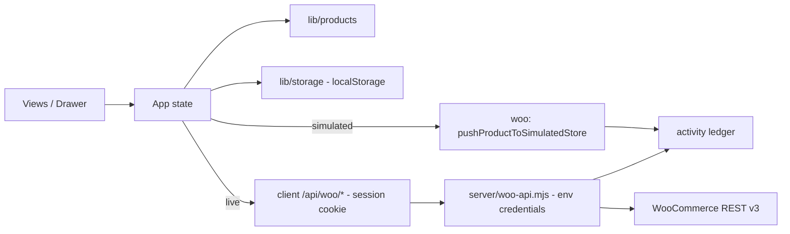

# PIM Sync

A product information workspace built for the **Kilowott Hackathon 2026** with React + Vite. The first screen is a
practical **Product Catalog**; a second **Synchronize** page handles the WooCommerce side.

## Problem

Hackathon brief: manage product information (catalog, attributes, media metadata) and keep it in step with a
WooCommerce store. Teams need to show a credible sync story without an actual store at hand — and without pretending
an untested integration works.

## Solution

1. **Product catalog management** — create, view, edit, delete, search and filter products, stored in the browser.
2. **Attribute handling** — colour, size, material, category, SKU, description, price, stock, plus free-form attributes (e.g. Finish, Ports) with comma-separated values.
3. **Data synchronisation** — per-product and bulk sync actions with plain-English statuses ("Synced", "Needs sync", "Sync failed"), timestamps, and an explicit distinction between **simulated demo mode** and a **live WooCommerce REST path** that runs through a **server-side proxy** (credentials never touch the browser).

> **Disclosure:** The default connector is **simulated demo mode**
> (**no network requests**). The live path is unit-tested against mocked transports, was exercised
> end-to-end against a **local mock WooCommerce API**, and has since been verified against a **real local
> WooCommerce 11.2.1 test store** (Local by Flywheel) through the server-side proxy — real product
> create, update and SKU lookup all succeeded. It has never been run against a production or remote
> store (see [Synchronisation behaviour](#synchronisation-behaviour)).

## Interface

A bold editorial operations workspace: cool porcelain canvas, dense ink typography and a single cobalt accent, set
in Space Grotesk (display), Inter (UI) and IBM Plex Mono (data) with system fallbacks. There is **no sidebar** — a
compact top chrome carries the brand mark, two workspace tabs with live counts and the theme toggle. The catalog
opens on an asymmetric masthead (oversized uppercase title beside a giant numeric index and a hairline statistics
grid), a sticky toolbar, then a manifest-style table with row numerals, colour swatches, labelled attribute chips
and clear row actions. Delete opens an in-app confirmation dialog (Escape or overlay cancels, the safe option is
focused first). The synchronize workspace pairs connection mode cards, key/value connection facts, a numbered
"what gets synchronized" field list, a queue and a run ledger. A full **light/dark theme** follows the system
preference on first visit and remembers any manual choice; an inline pre-paint script prevents theme flashes.
Motion is disabled under `prefers-reduced-motion`; the table scrolls horizontally on narrow screens and the layout
collapses cleanly at 1180 px, 980 px, 760 px and 560 px breakpoints.

## Demo video

> **Video walkthrough:** _placeholder — add the final demo video link (YouTube/Drive) here before submission._

## Features

- **Product Catalog (first screen)** — masthead totals (products, published, synced, need sync, low stock, last sync time), search across name/SKU/colour/size/material/category/description/attributes, filters (category, sync status), and a readable manifest table: row numerals, labelled attribute chips, category, price in ₹, stock with low-stock mark, store status, sync status with last-sync time and error message, plus **Sync**, **Edit** and **Delete** actions (Delete opens an in-app confirmation dialog).
- **Light & dark theme** — follows `prefers-color-scheme` until the user flips the toggle in the top chrome; the choice is remembered in `localStorage` and applied pre-paint by an inline script (no flash). Native controls follow the theme via `color-scheme`.
- **Add / Edit Product** — a prominent "Add Product" button opens a side drawer with numbered sections and inline validation; focus moves to the first invalid field; Escape or the overlay closes it.
- **Attribute handling** — structured colour/size/material fields plus repeatable custom attributes; values are trimmed, empties dropped and duplicates rejected. Colour names resolve to swatches, with a deterministic monogram-tile fallback.
- **Synchronize page** — connection mode (simulated vs live), a Connection panel with four explicit server states (checking / unreachable / unconfigured / configured), the exact missing environment variables, copy-ready setup commands, a required-restart note and a **Check again** button that genuinely re-fetches the server status; run actions (queue or entire catalog) stay disabled in live mode with plain-English reasons until the server reports a valid configuration; "What gets synchronized" field list, per-product queue, a "fail the next run" toggle for the error/retry flow (demo mode), and an activity ledger where every entry is tagged "Simulated demo" or "Live store" and the totals count each mode separately.
- **Persistence** — products, sync log and sync mode live in `localStorage`; legacy records are hydrated and malformed values repaired on load (see [Storage hardening](#storage-hardening)). If an older version stored credentials in the browser, they are purged on startup.

## Synchronisation behaviour

| | Simulated demo (default) | Live store (verified against a local test store) |
| --- | --- | --- |
| Network | none — local only | browser → local proxy (`/api/woo/*`) → store REST API |
| Auth | n/a | HTTP Basic added **server-side** from `WOO_CONSUMER_KEY`/`WOO_CONSUMER_SECRET` env vars |
| Credentials in browser | none | none — the client only sees `{ configured, storeHost, missing, urlError, insecureLocal }` |
| Proxy guard | n/a | session cookie + same-origin check + `X-PIM-Sync` header on writes; cross-origin/preflight → 403 |
| Create vs update | n/a (deterministic demo ID from SKU) | POST `/wp-json/wc/v3/products` to create; PUT `/wp-json/wc/v3/products/{id}` to update |
| SKU handling | n/a | on a `product_invalid_sku` conflict, the proxy looks the SKU up and updates the existing store product instead |
| Category handling | n/a | WooCommerce ignores name-only categories on writes, so the proxy resolves each named category to a term (by slug, creating it if missing) and writes term ids |
| Stock handling | n/a | payload includes `manage_stock: true` with `stock_quantity`, because WooCommerce ignores stock quantities when stock management is off |
| Verified how | unit tests + UI flows | unit tests with mocked fetch; middleware tests; **15/15 end-to-end checks against a local mock WooCommerce API**; a real local WooCommerce 11.2.1 store: create (id 13, draft, ₹1234.00, stock 7, category + attribute mapped), update (name/price ₹1499.00/stock 9), SKU lookup — all through the real dev proxy; never a production or remote store |

- Every log entry is tagged `Simulated demo` or `Live store`, so recorded history is never ambiguous; the ledger header and panels also count demo vs live runs separately.
- In live mode, run buttons are disabled until the proxy reports `configured: true`, with plain-English reasons on hover/inline; if the proxy is unreachable, the UI says so (and distinguishes it from missing configuration) and suggests `npm run dev` / `npm run preview` / `npm start`, plus a **Check again** button.
- A blocked live attempt never writes a success entry to the ledger, so demo runs can never be mistaken for real-store runs.
- Live sync has been run against a **local WooCommerce test store only** — never a production or remote store. The real-store pass proves the request shape, authentication header, create/update routing, SKU-conflict fallback, category resolution and error passthrough against WooCommerce 11.2.1; it does not prove compatibility with every host, plugin set or custom-field setup. Test against a staging store before trusting live mode.

## Security

- **Credentials stay server-side.** `WOO_STORE_URL`, `WOO_CONSUMER_KEY` and `WOO_CONSUMER_SECRET` are read from environment variables by the sync proxy (Vite dev/preview middleware or the standalone `npm start` server); they are never sent to, or stored in, the browser.
- `.env` and `.env.*` are gitignored (`.env.example` is the template); the proxy never echoes credentials — `/api/woo/status` returns only `configured`, the store host, which variables are missing and URL diagnostics.
- **The proxy is not an open relay.** `GET /api/woo/status` issues a short-lived `HttpOnly`, `SameSite=Strict` session cookie; every product route then requires that cookie, a same-origin `Origin` header and — for writes — an `X-PIM-Sync: 1` header. Cross-origin requests and preflights (`OPTIONS`) are rejected with 403, so a random web page cannot drive your store. No secret is ever needed by (or exposed to) the client for this.
- **HTTPS enforced.** Remote store URLs must be `https://`; plain HTTP is accepted only for local-development hosts — `localhost`/`127.0.0.1`/`::1` (and any 127.x.x.x), `*.localhost`, `*.local` and `*.test` reserved names, or private-network IPs (10.x, 172.16–31.x, 192.168.x) — and only with the explicit `WOO_ALLOW_LOCAL_HTTP=1` local-development flag (the UI badges this as "Local HTTP (dev only)"). Note: WooCommerce 8+ only performs Basic authentication over SSL, so even local stores should be configured with their HTTPS URL (e.g. `https://my-site.local`); across plain HTTP the store silently falls back to legacy OAuth and rejects every authenticated request with `woocommerce_rest_cannot_view`.
- **Safe failure messages.** Missing/invalid configuration → 503 with the exact problem; store timeouts → 504 `proxy_timeout`; network failure → 502; auth misses → 401 `proxy_unauthorized`; cross-origin → 403 `proxy_forbidden`.
- The proxy only exposes `GET /api/woo/status`, `GET /api/woo/products?sku=…`, `POST /api/woo/products` and `PUT /api/woo/products/{id}`; request bodies are capped at 1 MB; unknown routes return 404; upstream calls time out after 15 s.
- Legacy: earlier versions accepted credentials via a browser form and stored them in `localStorage`. That form is gone and `purgeLegacyConnectionSettings()` removes any leftover values on startup.

## Getting started

```bash
npm install
npm run dev       # dev server (also serves the /api/woo proxy); needs Node >= 22.15
npm run build     # production build
npm run preview   # serve the production build (also serves the /api/woo proxy)
npm start         # dependency-free standalone server: serves dist/ + the /api/woo proxy (build first)
npm run test      # node:test suites (97 tests)
npm run lint      # eslint
```

`dev`, `preview` and `start` run Node with `--use-system-ca` so that locally-trusted development
certificates (e.g. Local by Flywheel's router) are accepted without disabling TLS verification.

Live mode is optional and off until configured. To enable it:

```powershell
Copy-Item .env.example .env.local   # cp .env.example .env.local on macOS/Linux
# edit .env.local: WOO_STORE_URL (store HTTPS URL — WooCommerce requires SSL for Basic auth),
# WOO_CONSUMER_KEY, WOO_CONSUMER_SECRET
npm run dev                         # env files are read at startup — always restart after editing
```

Then open the Synchronize page → the Connection panel shows exactly which variables are missing, the exact
setup steps and a **Check again** button that re-reads the live server status. Run buttons stay disabled until
the server reports `configured: true`. Environment variables: `WOO_STORE_URL` (HTTPS; plain HTTP is accepted
only for local-development hosts — `localhost`, `*.local`, `*.test` or private-network IPs — and only when
`WOO_ALLOW_LOCAL_HTTP=1`), `WOO_CONSUMER_KEY`,
`WOO_CONSUMER_SECRET` (WooCommerce → Settings → Advanced → REST API), and `PORT` for `npm start` (default
4173). Existing `process.env` values win over `.env`/`.env.local`.

First run loads six seed products (including the required **Black T-Shirt, TSH-001, ₹499, 20 in stock**).
To start clean, clear the `kilowott-pim-sync/*` keys from localStorage.

## Validation rules

| Field | Rule |
| --- | --- |
| Name | required, ≥ 2 characters |
| SKU | required, unique across the catalog (case-insensitive), trimmed |
| Category | required (select from a list plus "Uncategorized") |
| Price | required, numeric, ≥ 0 (₹) |
| Stock | required, whole number, ≥ 0 |
| Colour / Size / Material | optional free text; trimmed |
| Custom attributes | each row needs a name and ≥ 1 value; names unique (case-insensitive) |

## Storage hardening

`loadProducts` / `loadSyncLog` defend against malformed `localStorage` data: non-array payloads and corrupted JSON
fall back to seeds/empty; non-object records are dropped; unknown enum values (`status`, `syncStatus`) reset to
safe defaults; negative or non-numeric price/stock clamp to 0; malformed attribute rows are repaired or dropped;
the sync log is capped at 50 entries. All of this is covered by tests.

## Architecture

```
server/
  index.mjs                standalone server for `npm start`: serves dist/ + the proxy (loads .env/.env.local)
  woo-api.mjs              sync proxy (config validation, session-cookie/origin guards, WooCommerce client) for dev + preview + start
src/
  App.jsx                  shell, state, persistence, sync orchestration, theme, toasts
  index.css                design system (light/dark tokens, layout, components)
  lib/
    products.js            model, seeds, validation, search, stats, swatches, ₹ formatting
    storage.js             localStorage read/write, record hydration/hardening, legacy purge
    theme.js               theme resolution, storage and DOM application helpers
    woo.js                 payload mapping, simulated connector, client for the sync proxy
  components/
    TopChrome.jsx          brand, workspace tabs with counts, theme toggle
    ProductsView.jsx       Product Catalog: masthead, toolbar, manifest table, actions
    ProductForm.jsx        create/edit drawer with validation
    SyncView.jsx           mode switch, connection states + setup steps, runs, ledger
    ui.jsx                 icons, brand mark, tags, swatch, drawer, confirm dialog, empty state, spinner
tests/                     node:test suites (products, storage, theme, woo client, woo proxy)
```

Product model:

```js
{
  id, name, sku, category, description, price, stock,
  status: 'draft' | 'published',
  color, size, material,                       // structured attributes
  attributes: [{ id, name, values: [] }],      // free-form attributes
  wooId: null | number,
  syncStatus: 'pending' | 'synced' | 'error',
  syncError: null | string,
  lastSyncedAt: null | ISO string,
  lastSyncMode: null | 'simulated' | 'live',   // historical, kept across edits
  createdAt, updatedAt
}
```



## Testing

`npm run test` (Node's built-in test runner, no extra dependencies): **97 tests, all passing**.
`npm run lint` is clean and `npm run build` succeeds; the production preview serves 200.

- `tests/products.test.js` — validation (required fields, duplicate SKUs, invalid prices, negative/fractional stock, attribute rules), normalisation, `removeProduct`, search across all attribute fields, filters, stats, seed check for the required Black T-Shirt, ₹ formatting, swatch/monogram helpers, `lastSyncMode` defaults preserved through edits.
- `tests/storage.test.js` — seed fallback without browser storage, legacy-record hydration, corrupted JSON, malformed records/attributes/log entries, log cap, sync-mode guard, legacy credential purge, `lastSyncMode` repair (valid values kept, unknown values nulled).
- `tests/theme.test.js` — stored-vs-system preference resolution, toggling, localStorage round-trip, malformed stored values ignored, graceful no-window behaviour, media-query reads, DOM application.
- `tests/woo.test.js` — disclosure constants, payload mapping (incl. structured attributes, `manage_stock`), simulated success/re-sync/forced failure, live client against a mocked transport (POST create with no credentials in the browser, PUT update, SKU-conflict fallback, error codes/statuses, 401 surfacing, unreachable proxy, status lookup with URL diagnostics, encoded SKU query, `lastSyncMode` tagging, `liveBlockReason` states).
- `tests/woo-api.test.js` — config parsing incl. HTTPS enforcement and the local-HTTP flag, secret-free public status, session-cookie issuance, 401 without cookie, 403 cross-origin, OPTIONS rejection, `X-PIM-Sync` write guard, Basic auth added server-side, payload/query forwarding, category resolution (create missing terms, reuse by slug, pass ids through, safe failure passthrough), store error mapping, 504 timeout and 502 network mappings, unconfigured refusal, middleware routing, sku normalisation, invalid JSON, oversized bodies, 404s.

Beyond unit tests:

- The live path was exercised end-to-end against a **local mock WooCommerce API** (a temporary Node script, not shipped) through the real Vite dev proxy: **15/15 checks passed** — status proves configured without leaking credentials, `HttpOnly`/`SameSite=Strict` cookie issuance, 401 without cookie, 401 without the `X-PIM-Sync` write header, 403 on cross-origin and preflight, same-origin acceptance, POST create, PUT update, SKU lookup, and the mock confirming server-side Basic auth and the mapped payload — with rejected requests never reaching the store.
- The live path was then exercised against a **real local WooCommerce 11.2.1 store** (Local by Flywheel, HTTPS router URL, self-signed cert trusted for the current user) through the real dev proxy, using the app's own payload mapper: the proxy status reported `configured` with no URL error and issued its session cookie; a **create** produced a real draft product with the mapped category (*Apparel*, created as a term on demand), all four mapped attributes (Color/Size/Material/Finish), price ₹1234.00 and stock 7; an **update** changed name, price (₹1499.00) and stock (9) on the same product; a **SKU lookup** found the updated product. Findings along the way, all fixed: WooCommerce ignores name-only categories and untracked stock quantities (hence proxy-side category resolution and `manage_stock`), and WooCommerce 8+ only performs Basic auth over SSL (hence the HTTPS store URL).
- Debugging that real store required two WordPress-host fixes, both made and verified outside this repo: the Local site's nginx config was missing `fastcgi_param HTTP_AUTHORIZATION $http_authorization;` (the Authorization header never reached PHP — added to both the rendered config and the site template), and the Local router certificate was trusted into the current user's Root store so `--use-system-ca` could verify it.
- The **standalone `npm start` server** was probed directly: app shell and static assets 200, path traversal blocked, status configured from its own `.env.local`, 401 without cookie, 403 on OPTIONS, and a safe `proxy_network_error` when the store was down.
- UI views passed **21 SSR smoke checks** (connection states: checking / unreachable / unconfigured / URL error / configured / insecure-local, demo-vs-live ledger split, mode-tagged catalog rows) via a temporary Vite SSR build (the harness strips React SSR comment separators before matching text). The dev server was also probed live: `/`, `/src/index.css`, `/favicon.svg` and `/api/woo/status` all returned 200.

## AI usage

This project was developed with AI assistance (opencode). What was AI-assisted and how it was verified:

1. **Full visual redesign (earlier pass)** — AI replaced the previous ivory/vermilion sidebar layout with a bold editorial workspace: new top chrome (brand mark, tab navigation with counts, theme toggle), asymmetric mastheads, a manifest-style catalog table, restructured synchronize panels, an in-app delete confirmation dialog (replacing `window.confirm`), a full light/dark token system and an inline pre-paint theme script. Verified by 10 theme tests, clean lint, a successful production build, SSR smoke renders of the new views, live dev-server probes, and a manual pass over the rendered markup for class coverage.
2. **Live-mode configuration UX (this pass)** — AI rewrote the synchronize connection panel around four explicit server states (checking / unreachable / unconfigured / configured) with the exact missing variables, exact setup commands, a required-restart note and a genuinely re-fetching **Check again** button; live run buttons now stay disabled with plain-English reasons until the server reports a valid configuration. Sync entries carry a `lastSyncMode` tag so the ledger, catalog and panels separate demo from live history (a blocked live attempt never records a run). Verified by 18 new/updated unit tests, 21 SSR smoke checks, and the mock-store end-to-end run.
3. **Proxy security hardening (this pass)** — the sync proxy now enforces HTTPS for remote stores (`WOO_ALLOW_LOCAL_HTTP=1` only for localhost dev), issues an `HttpOnly`/`SameSite=Strict` session cookie from `/api/woo/status`, requires same-origin + cookie (+ `X-PIM-Sync` on writes) on product routes, rejects preflights and cross-origin calls with 403, times out upstream calls at 15 s and maps failures to safe error codes (503/504/502/403/401). AI also added a dependency-free standalone server (`server/index.mjs`, `npm start`) so the hardened proxy runs outside Vite in production. Verified by the rewritten 27-test middleware suite, the 15/15 mock end-to-end run, and direct standalone-server probes.
4. **Accessibility in the redesign** — the theme toggle announces its target (`Switch to dark/light theme`), tabs use `aria-current`, the delete confirmation is a focus-managed `role="alertdialog"` whose safe action is focused first, and all motion is disabled under `prefers-reduced-motion`. Verified by code review and SSR renders, not by an automated a11y tool.
5. **Server-side credentials refactor (earlier pass)** — AI moved WooCommerce credentials out of the browser into a dependency-free Node middleware (`server/woo-api.mjs`) wired into Vite dev + preview, rewrote the client connector to call `/api/woo/*`, and replaced the browser credential form with a secret-free status panel. Verified by middleware unit tests, the mock-store end-to-end run, lint, build, and SSR renders of all connection states.
6. **Storage hardening** — AI rewrote `hydrateProduct`/log loading to repair or drop malformed `localStorage` data and added the legacy-credential purge. Verified by new tests covering null/primitive records, string prices, negative stock, unknown enums and broken attribute rows.
7. **Code review of the existing implementation** — earlier AI review flagged edge cases (empty attribute rows ignored rather than erroring, case-insensitive SKU uniqueness, graceful swatch fallback, legacy record hydration); each is covered by a test.
8. **Test generation** — the `node:test` suites were drafted with AI assistance. Two AI-drafted tests were wrong on first run (an empty-attribute expectation and an error-message regex) and were corrected; assertions were then read against the implementation before acceptance.
9. **Design system, earlier pass** — the first editorial layout was drafted with AI assistance; the redesign supersedes it.
10. **Real-store connection pass (this pass)** — AI connected the live path to a real local WooCommerce 11.2.1 store: extended the local-development host rules (`*.local`/`*.test`/private IPs) with tests, diagnosed the store's 401s to three causes (missing nginx `HTTP_AUTHORIZATION` param, WooCommerce's SSL-only Basic auth, category/stock semantics), fixed the app payload (`manage_stock`) and added proxy-side category resolution with four new unit tests, and ran a full create/update/SKU-lookup verification through the dev proxy. Verified by 97 passing tests, clean lint, a successful build, and the recorded real-store run above. Credentials live only in the gitignored `.env.local` and were never printed.

AI did not run a browser interactively and performed no deployment or store operations beyond the local test
store described above. No test results or agent activity in this README are fabricated — every command and
count listed here was executed in this repository.

## Connecting a real store (exact steps)

1. In WooCommerce: **Settings → Advanced → REST API → Add key** — choose Read/Write permissions, generate, and copy
   the Consumer key (`ck_…`) and Consumer secret (`cs_…`).
2. In the project folder, create the env file:
   `Copy-Item .env.example .env.local` (PowerShell) or `cp .env.example .env.local`.
3. Fill in `WOO_STORE_URL=https://your-store.example` (must be HTTPS; HTTP is only allowed for local-development
   hosts — `localhost`, `*.local`, `*.test`, private-network IPs — with `WOO_ALLOW_LOCAL_HTTP=1`), `WOO_CONSUMER_KEY=ck_…`, `WOO_CONSUMER_SECRET=cs_…`.
4. **Restart the server** — env files are read at startup: stop it, then `npm run dev` (or `npm run build` +
   `npm start` for the standalone server).
5. Open **Synchronize**, select **Live store**, and press **Check again**; the panel should show
   `Configured · <store host>` with credentials "Held server-side".
6. Try one product on a **staging store first**. Watch the ledger: every live run is tagged `Live store` with the
   upstream result or its safe error code.

For a **local development store** (e.g. Local by Flywheel): use the store's **HTTPS** URL — WooCommerce 8+ only
does Basic auth over SSL — and make sure the local certificate is trusted (`npm run dev` already runs Node with
`--use-system-ca`; the `dev` script requires Node ≥ 22.15). If every request returns `woocommerce_rest_cannot_view`
even with correct keys, check that the web server forwards the `Authorization` header to PHP (nginx sites may need
`fastcgi_param HTTP_AUTHORIZATION $http_authorization;`).

The live path has been verified against a local WooCommerce test store (see above) but never against a production
or remote store — treat the first attempt there as a test, not a production operation.

## Assumptions and limitations

- Single user, browser-only; there is no backend beyond the sync proxy (Vite dev/preview middleware or the standalone `npm start` server), no auth between users and no multi-user concurrency.
- A static-only production deployment needs the standalone server (`npm run build && npm start`) or an equivalent server route to use live mode; the hardened proxy deliberately rejects cross-origin use.
- Remote stores must be HTTPS; plain HTTP is only accepted for local-development hosts (`localhost`, `*.local`, `*.test`, private-network IPs) with `WOO_ALLOW_LOCAL_HTTP=1` — a local-development escape hatch, never use it for a remote store.
- Env files are read at server startup, so every `.env.local` change requires a restart; the UI's **Check again** re-reads the server status but cannot pick up un-restarted changes.
- The live path has been run against a **local WooCommerce test store only** — never a production or remote store; the real-store pass does not prove compatibility with every host, plugin or custom-field setup.
- Prices are displayed in ₹ (INR); no tax or multi-currency logic.
- The sync log is capped at 50 entries; demo Woo IDs are deterministic per SKU, so they are stable but not real store IDs.
- Seed data is illustrative; there is no import/export, bulk editing or image handling.
- Credentials live in `.env.local` on the machine running the server — appropriate for a hackathon demo, not a hardened production setup (no rate limiting, no TLS termination of its own, no key rotation).
